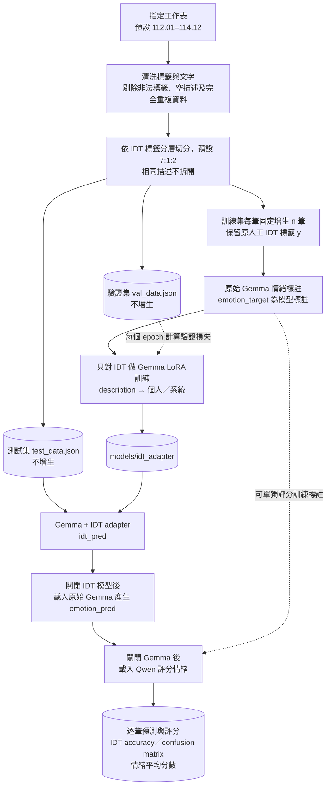

# Medical-Incident-NLP

以本機 Hugging Face 模型處理醫療事件報告：判斷事件偏向「個人」或「系統」因素（IDT），並標註撰寫者的情緒。

- **IDT 分類**有人工標籤（`個人`／`系統`），因此對 Gemma 做 LoRA fine-tuning，並用 accuracy 與 confusion matrix 評估。
- **撰寫者情緒**沒有人工標籤，不做 fine-tuning、也不計算 accuracy。Gemma 標註情緒後，由 Qwen 依文字證據給出 1–5 分與理由。

| 工作 | 預設模型 | 輸入與輸出 |
| --- | --- | --- |
| 訓練資料改寫 | [google/gemma-4-E2B-it](https://huggingface.co/google/gemma-4-E2B-it) | 改寫 `content.description`，保留人工 `idt_target` |
| 撰寫者情緒標註 | [google/gemma-4-E2B-it](https://huggingface.co/google/gemma-4-E2B-it) | 從事件描述選出一個情緒標籤 |
| IDT LoRA 訓練與推論 | [google/gemma-4-E2B-it](https://huggingface.co/google/gemma-4-E2B-it) + 本專案 adapter | 事件描述 → `個人`／`系統` |
| 情緒品質評分 | [Qwen/Qwen3.5-9B](https://huggingface.co/Qwen/Qwen3.5-9B) | 事件描述 + Gemma 情緒 → 三項分數、平均分與理由 |

兩個預設模型皆為 Apache-2.0 授權。

設計上的幾個原則：

- 模型只讀 `content.description`。`content.directive`（批示）保留在資料裡，但不送進任何模型。
- 失敗就中止，不用預設值掩蓋。例如情緒標註輸出無效時，重試後仍失敗就停止，不會補成「中性」。唯一的例外是增生：某筆湊不滿改寫時，預設保留已取得的版本並列出缺額，可用 `--augment-on-failure abort` 改為中止。
- 各階段以 JSON 檔案交接，可單獨重跑；寫入先完整序列化再原子替換，失敗不會截斷既有檔案。
- 模型依序載入與釋放，不會同時占用 IDT Gemma、情緒 Gemma 與 Qwen 的記憶體。

## 資料流程



| 階段 | 實作 | 行為 |
| --- | --- | --- |
| 讀取與清洗 | [src/data_preprocessing.py](src/data_preprocessing.py) | 讀取指定月份的工作表（Excel 或先前清洗輸出的 JSON），整理欄名與文字，正規化 IDT 標籤，剔除非法標籤、空描述及相同標籤／描述／批示的完全重複資料，保留來源識別碼 |
| 資料切分 | [src/data_split.py](src/data_split.py) | 依 `--split-ratio`（預設 7:1:2）切成訓練／驗證／測試；以 IDT 標籤分層，描述相同的紀錄不拆開；發生在增生之前 |
| 固定資料增生 | [src/data_augmentation.py](src/data_augmentation.py) | 只對訓練集，每筆新增 `n` 個非空、互異且不與已知描述完全相同的改寫，沿用原人工 IDT 標籤；每個改寫單獨呼叫一次模型，不合格就重試；每完成一筆即存進度，中斷後可續跑（見「增生的失敗處理與續跑」） |
| 情緒標註 | [src/feature_engineering.py](src/feature_engineering.py) | 只對訓練集，用原始 Gemma 產生 `emotion_target`，記錄模型來源及 `emotion_annotation_is_gold=false`；逐筆存進度，中斷後可續跑（見「情緒標註的進度與續跑」） |
| IDT LoRA 訓練 | [src/trainer.py](src/trainer.py) | 以人工 `idt_target` 做 supervised fine-tuning，僅 assistant 的分類標籤與結束 token 計入 loss；每個 epoch 結束以驗證集計算損失；儲存 adapter、tokenizer 與訓練資訊 |
| 測試集推論 | [src/inference.py](src/inference.py) | 對切分出的測試集，分別以 IDT adapter 與原始 Gemma 產生 `idt_pred`、`emotion_pred`，再用 Qwen 評分情緒 |
| 評估與評分 | [src/evaluation.py](src/evaluation.py) | IDT 與人工標籤比對；情緒由 Qwen 評分。可對既有預測單獨重新評分，無須載入 Gemma |

訓練與推論使用同一份 IDT 提示詞（[src/prompts.py](src/prompts.py) 的 `IDT_SYSTEM_PROMPT`），其 SHA-256 會記錄在訓練 metadata。

### 資料切分

清洗後的資料依 `--split-ratio` 切分，預設 `7 1 2`，即訓練 70%、驗證 10%、測試 20%：

- **分層**：以人工 IDT 標籤分層，讓稀少的 `系統` 類別在三個集合維持相近比例。
- **相同描述不拆開**：描述文字完全相同的紀錄視為同一組，一定落在同一集合，避免同一段事件文字同時出現在訓練與測試。
- **先切分再增生**：改寫版本一定與其原文同在訓練集；驗證與測試集維持原文，不增生、不標註情緒。
- **隨機切分，不依月份先後。** `--split-seed`（預設 `42`）與訓練的 `--seed` 分開；相同資料、比例與種子會得到相同切分。

訓練集若有 `N` 筆，預設 `--augment-n 2` 會保留原文並新增 `2N` 筆，合計 `3N` 筆。驗證集只用來在每個 epoch 結束計算損失並寫入 `training_metadata.json`，供觀察過擬合；不用於挑選 checkpoint，也不是最終成績。最終 IDT accuracy 以測試集計算。

**資料或切分設定變動後，請重新執行 `prepare` 並重新訓練。** 用舊 adapter 評估新切分的測試集，可能包含該 adapter 訓練時已看過的紀錄。

改寫提示詞要求保留醫療事實、因果、角色責任及不確定性。程式可驗證格式、數量、重複情形與標籤是否沿用，但改寫是否完整保留語意仍需研究者抽查。

### 增生的失敗處理與續跑

增生要逐筆呼叫模型，是整個流程最耗時的階段之一。規則如下：

- **每個改寫單獨要求一次**：一次要求多個時，模型常只回一個（實測隨機 10 筆中有 2 筆），逐個要求則每次回應都能獨立驗收。
- **不合格就重試**：回應不是合法 JSON、是空字串，或與原文、其他描述、已產生版本完全相同，就重試，每個版本最多嘗試 4 次；重試時會提示模型上一次不可用。
- **生成上限隨原文放大**：每次生成的 token 上限取 `--max-new-tokens` 與「原文字數 × 1.2 ＋ 200」的較大者，長描述才不會被固定上限截斷。
- **湊不滿時的處理**由 `--augment-on-failure` 決定：
  - `keep-partial`（預設）：保留已取得的版本，缺額列在輸出檔旁的 `train_augmented.shortfalls.json`，整批繼續。
  - `abort`：任何一筆湊不滿就中止，維持「每筆固定增生 `n` 筆」。
  - 兩種模式下，**模型呼叫本身失敗**（如顯存不足）都會立即中止；`keep-partial` 下**連續 5 筆**湊不滿也會中止，視為模型輸出或提示詞出了系統性問題。
- **進度與續跑**：每完成一筆就追加到 `train_augmented.json.partial.jsonl`；中斷（或中止）後重新執行同一指令，會從上次的位置繼續。進行到一半時，若輸入資料、`--augment-n`、模型或提示詞改變，程式會拒絕沿用舊進度（避免默默丟掉數小時的結果），請確認後刪除進度檔再重跑。
- **完成後略過**：全部完成後才寫出 `train_augmented.json`、刪除進度檔，並在旁邊留下 `train_augmented.json.done.json` 完成標記。之後輸入與設定都沒變時再次執行 `prepare` 會直接略過增生，因此 `prepare` 可以隨時安全重跑（例如後面的情緒標註中斷時，不會重做增生）；輸入或設定改變則照常重做。要強制重做，請刪除輸出檔與完成標記。

進度顯示 `[76/2302] 已增生 2 筆（呼叫 2 次；預估剩餘 …）` 中，編號是第幾筆原文／原文總數；「呼叫」是該筆實際呼叫模型的次數，多於 `n` 代表有重試；預估剩餘時間依本次已生成的平均速度推算。

生成速度取決於硬體：在 RTX 3060 12GB 上實測約 11–12 token/秒，訓練集 2302 筆、`n=2` 的增生預估約 14–16 小時（不含重試）。較快的 GPU 可大幅縮短，也可以用 `--augment-n 1` 減半。

### 情緒標註的進度與續跑

情緒標註（約 6906 次呼叫）同樣逐筆存進度：

- 每標註一筆就追加到 `train_features.json.partial.jsonl`；中斷（含 Ctrl+C）或失敗後重新執行同一指令，會從上次的位置繼續。進行到一半時，若輸入資料、模型或標註提示詞改變，程式會拒絕沿用舊進度，請確認後刪除進度檔再重跑。
- 全部完成後才寫出 `train_features.json`、刪除進度檔，並留下 `train_features.json.done.json` 完成標記；之後輸入與設定都沒變時再次執行會直接略過，要強制重做請刪除輸出檔與完成標記。
- 輸出無效（不是合法 JSON 或不在 10 種情緒內）會重試 2 次，仍失敗就中止，不補成「中性」；已完成的紀錄都在進度檔裡，不會遺失。
- 標註使用溫度 0（貪婪解碼，結果可重現），因此重試通常得到相同輸出。若某筆確實無法得到合法標籤，重跑會停在同一筆，需要調整提示詞或模型後再繼續。
- 進度顯示 `[情緒標註 12/6906] 焦慮（預估剩餘 …）`，編號是第幾筆／總筆數。
- 速度：在 RTX 3060 12GB 上隨機抽 150 筆實測，平均 0.85 秒／筆、無一筆需要重試或失敗，6906 筆約 1.6 小時。描述越長越慢（≤100 字約 0.7 秒，>400 字約 1.4 秒）。

## 環境與安裝

需要 Python 3.11 以上。目前的開發環境是 Windows 11、conda `py313`（Python 3.13）、RTX 3060 12GB：

| 套件 | 最低需求 | 開發環境版本 |
| --- | --- | --- |
| `torch` | 2.4 | 2.14.1+cu126 |
| `transformers` | 5.10.1（Gemma 4 需要），<6 | 5.19.0 |
| `peft` | 0.19.0，<1 | 0.21.2 |
| `accelerate` | 1.1.0 | 1.15.0 |
| `sentencepiece` | 0.2 | 0.2.2 |
| `pandas` | 2.0 | 3.0.6 |
| `openpyxl` | 3.1 | 3.1.5 |

**先安裝與硬體相符的 PyTorch。** Windows 上直接 `pip install torch` 只會裝到 CPU 版；要用 NVIDIA GPU，需指定 CUDA 的安裝來源（可到 [pytorch.org](https://pytorch.org/get-started/locally/) 查詢符合驅動的版本）：

```bash
conda activate py313
python -m pip install torch --index-url https://download.pytorch.org/whl/cu126
python -m pip install -r requirements.txt
python -c "import torch; print(torch.cuda.is_available(), torch.cuda.get_device_name(0))"   # 應顯示 True 與 GPU 名稱
```

[requirements.txt](requirements.txt) 列出直接依賴與最低版本；上表的「開發環境版本」是目前實際使用的版本，需要完全重現時請依該表固定版本。

不使用 conda 時，改用虛擬環境（`python -m venv .venv`）並啟用後執行同樣的 `pip` 指令。

模型與 tokenizer 由 Hugging Face `from_pretrained` 載入，首次執行會下載到 Hugging Face 快取（Windows 預設在 `%USERPROFILE%\.cache\huggingface`，可用環境變數 `HF_HOME` 改位置）。本專案只處理文字，因此使用 `AutoTokenizer` 的原生 chat template，模型由 `AutoModelForMultimodalLM` 載入，不初始化影像／音訊 processor。改用需要存取授權的模型時，設定 Hugging Face 標準的 `HF_TOKEN` 環境變數；程式不會載入 `.env`。

`--gemma-model` 與 `--judge-model` 也接受本機模型目錄；完整模型已在本機時，加上 `--local-files-only` 可禁止下載。

### 硬體注意事項

以下由參數量推算，實際用量依序列長度與 batch 而定，請以自己的環境為準：

- Gemma 4 E2B-it 約 5.1B 參數、Qwen3.5-9B 約 9.7B 參數；以 bf16 計，權重分別約 10 GB 與 19 GB，首次下載合計約 30 GB。
- **LoRA 訓練建議 24GB 以上顯存。** 在 RTX 3060 12GB（Windows）實測訓練 6 筆樣本（含最長的一筆，batch 1、gradient checkpointing 開啟）：顯存配置峰值達 19.5 GiB。Windows 驅動會把超出的部分放到系統記憶體，所以不一定報錯，但速度會崩潰：中位長度的樣本約 6.6 秒，最長那筆單步要一百多秒。主因是每筆訓練序列至少約 1,500 token（IDT 提示詞本身約 1,400 token），而詞彙表約 26 萬，輸出 logits 就要數 GB。
- 模型推論（改寫、情緒標註）在 12GB 顯卡上可以執行，約占 10 GB 顯存。Qwen 評分放不進顯存，CUDA 推論時 Accelerate 會自動把部分權重放到 CPU 記憶體，可以執行但很慢。
- LoRA 訓練使用單一裝置；`--device auto` 依序選擇 CUDA、MPS、CPU，`--device cuda` 在 CUDA 不可用時會明確失敗。
- 真實訓練與 9B 模型評分建議在顯存充足的 GPU 伺服器上執行。

## 快速開始

以下範例使用 bash 的 `\` 續行；PowerShell 請改用反引號（`` ` ``）或寫成單行。所有命令都在專案根目錄執行。

**1. 準備資料。** 預設資料來源是 `data/raw_data/data.json`（作法見「資料」一節）。

**2. 檢查設定但不執行。** `--dry-run` 列出階段、模型、訓練設定與路徑，不讀取資料、不下載模型、不寫入檔案；它不會檢查 GPU、模型存取權或資料內容。

```bash
python run.py all --device cuda --dry-run
```

**3. 先跑小規模冒煙測試（建議）。** 只用 `112.01` 一個月，輸出放在獨立目錄，用來提早確認模型能下載、改寫輸出格式穩定、顯存足以訓練：

```bash
python run.py train --device cuda --sheets 112.01 --augment-n 2 --epochs 0.1 \
  --cleaned-data data/smoke/cleaned.json --train-data data/smoke/train.json \
  --val-data data/smoke/val.json --test-data data/smoke/test.json \
  --train-augmented data/smoke/train_augmented.json \
  --train-features data/smoke/train_features.json --models-dir models/smoke
```

**4. 正式執行。** 預設納入全部 36 個月並以 7:1:2 切分：

```bash
python run.py all --device cuda --models-dir models/run1 --out-dir results/run1
```

## 使用方式

| 模式 | 執行內容 |
| --- | --- |
| `prepare` | 讀取／清洗 → 7:1:2 切分 → 訓練集固定增生 → 訓練集 Gemma 情緒標註 |
| `train` | `prepare` → IDT LoRA 訓練（含驗證損失） |
| `inference` | 使用 `prepare` 切出的測試集 → IDT adapter 推論 → 原始 Gemma 情緒標註 → Qwen 評分 |
| `evaluate` | 讀取既有標註／預測，用 Qwen 評分情緒 |
| `all` | `train` → `inference` |

**分階段執行**：先完成資料準備，再重用準備好的 `train_features.json` 與 `val_data.json` 訓練，最後推論：

```bash
python run.py prepare --device cuda --augment-n 2
python run.py train --device cuda --reuse-prepared
python run.py inference --device cuda
```

- `train` 不加 `--reuse-prepared` 時會重新執行資料準備。
- `--augment-n 0` 表示不新增改寫，仍會對原文標註情緒並訓練。
- `inference` 直接使用 `prepare` 切分出的 `test_data.json`，不會重新讀取資料或重新切分，因此需先執行過 `prepare`（或 `train`、`all`）；找不到該檔會在載入模型之前報錯。
- `--reuse-prepared` 讓 `train` 與 `all` 略過 `prepare`，直接使用既有的 `--train-features` 與 `--val-data`；`all --reuse-prepared` 的推論使用既有的 `--test-data`。重用時請確認這些檔案來自同一次切分，且情緒標註來源符合這次實驗。

**推論與情緒評分分開執行**：先完成 Gemma 推論，再單獨載入 Qwen：

```bash
python run.py inference --device cuda --skip-emotion-evaluation
python run.py evaluate --device cuda
```

`evaluate` 預設讀取 `--out-dir/inference_predictions.json`，評分欄位預設為 `emotion_pred`。Qwen 輸出格式或分數無效時會重試，仍失敗則明確中止；Gemma 已完成的預測會保存在 predictions 檔案，評估檔會標記情緒尚未評分，可再用 `evaluate` 重試。

訓練集的 Gemma `emotion_target` 也可以單獨評分，結果寫到獨立目錄，不影響測試集結果：

```bash
python run.py evaluate --device cuda \
  --evaluation-input data/interim/train_features.json \
  --prediction-field emotion_target \
  --out-dir results/train_emotion
```

**更新資料、改用其他切分**：

```bash
python run.py all --device cuda \
  --raw-file /path/to/updated_incidents.xlsx \
  --sheets 114.01 114.02 114.03 114.04 114.05 114.06 \
  --split-ratio 8 1 1 \
  --models-dir models/updated_experiment \
  --out-dir results/updated_experiment
```

範例月份需替換成檔案中實際存在的工作表。需要分開保存實驗時，使用不同的 `--models-dir` 與 `--out-dir`；指定的路徑若已有檔案會被更新或覆寫。

### 主要參數

完整參數可由 `python run.py --help` 查看；設定類別定義於 [src/config.py](src/config.py)。

| 參數 | 預設值 | 用途 |
| --- | --- | --- |
| `--raw-file` | `data/raw_data/data.json` | 資料來源，可為清洗後的 JSON 或原始 Excel |
| `--sheets` | `112.01`–`114.12` | 納入切分的工作表，接受多個名稱 |
| `--split-ratio` | `7 1 2` | 訓練、驗證、測試比例，只看相對大小，三個數都需大於 0 |
| `--split-seed` | `42` | 資料切分的隨機種子，與訓練的 `--seed` 分開 |
| `--augment-n` | `2` | 訓練集每筆原文新增的改寫數 |
| `--augment-on-failure` | `keep-partial` | 某筆湊不滿 `n` 個改寫時：`keep-partial` 保留已取得的版本並記錄缺額；`abort` 立即中止 |
| `--cleaned-data`／`--train-data`／`--val-data`／`--test-data` | `data/processed_data/` 下的 `cleaned_data`／`train_data`／`val_data`／`test_data`（`.json`） | 清洗與切分輸出路徑 |
| `--train-augmented`／`--train-features` | `data/interim/train_augmented.json`／`train_features.json` | 增生與情緒標註輸出路徑 |
| `--models-dir`／`--out-dir` | `models`／`results` | adapter 與預測、評估輸出目錄 |
| `--gemma-model` | `google/gemma-4-E2B-it` | 改寫、情緒標註及 IDT 訓練的基礎模型 |
| `--judge-model` | `Qwen/Qwen3.5-9B` | 情緒評分模型 |
| `--device`／`--dtype` | `auto`／`auto` | 執行裝置與模型精度 |
| `--seed` | `42` | 模型載入與訓練的隨機種子 |
| `--max-new-tokens` | `1024` | 模型生成的最大 token 數 |
| `--epochs` | `3.0` | IDT 訓練 epochs |
| `--batch-size` | `1` | 每個裝置的訓練 batch size |
| `--gradient-accumulation-steps` | `8` | 梯度累積次數 |
| `--learning-rate` | `2e-4` | IDT 訓練學習率 |
| `--max-length` | `4096` | 訓練完整對話的 token 上限，包含 IDT system prompt |
| `--lora-rank`／`--lora-alpha`／`--lora-dropout` | `8`／`16`／`0.05` | LoRA 設定 |
| `--reuse-prepared` | 關閉 | 略過 `prepare`，重用既有的準備結果 |
| `--skip-emotion-evaluation` | 關閉 | 推論後暫不載入 Qwen，之後以 `evaluate` 評分 |
| `--local-files-only` | 關閉 | 只使用已下載的模型 |

LoRA 預設只訓練文字模型 `language_model` 下的 `q_proj`、`v_proj`，避免將影像及音訊層納入。gradient checkpointing 預設開啟，可用 `--no-gradient-checkpointing` 關閉。樣本超過 `--max-length` 時會明確失敗並要求提高上限，程式不會截斷事件描述或分類標籤。載入 IDT adapter 時會檢查它的基礎模型是否與 `--gemma-model` 一致。Qwen 評分的生成 token 上限至少為 512，以容納三項分數與理由。

## 資料

**來源。** 預設讀取 `data/raw_data/data.json`，它是由原始 Excel 清洗後輸出的紀錄。前處理依 `source_id` 的工作表名稱選取月份。也可以用 `--raw-file` 直接指定原始 Excel；Excel 的必要欄位為 `IDT分析(個人,系統)`、`事件描述`、`批示`，副檔名不是 `.json` 就會當成 Excel 讀取。

**清洗規則。** 正規化 IDT 標籤（全形字元與空白），剔除不是 `個人`／`系統` 的列（含空白，視為未標註）、描述為空的列，以及標籤／描述／批示三者都相同的重複列。每次執行都會回報輸入筆數、非法標籤、空描述、重複與輸出筆數。

**以 Excel 更新 `data.json`。** 取得新的 Excel 後，重新產生 JSON（會覆寫既有的 `data.json`，請先備份）：

```bash
python -c "from src import data_preprocessing as dp; dp.run(dp.ALL_SHEETS, 'data/raw_data/data.json', raw_file='data/raw_data/新資料.xlsx')"
```

**目前資料（2026-10-14 的快照，更新後會不同）。** Excel 的 112.01–114.12 共 6139 列，其中 IDT 欄空白 2724 列、填入非「個人／系統」值（如病房或床號）123 列、重複 4 列，清洗後為 3288 筆（個人 2976、系統 312）。預設 7:1:2 切分為訓練 2302（個人 2084、系統 218）、驗證 328（297、31）、測試 658（595、63）。

### 紀錄格式

以下為合成示例：

```json
{
  "idt_target": "系統",
  "emotion_target": "中性",
  "content": {
    "description": "已記錄流程並完成通報。",
    "directive": "持續檢視作業流程。"
  },
  "record_id": "112.01:2",
  "source_id": "112.01:2",
  "is_augmented": false,
  "augmentation": null,
  "emotion_annotation_model": "google/gemma-4-E2B-it",
  "emotion_annotation_source": "llm_generated",
  "emotion_annotation_is_gold": false
}
```

| 欄位 | 意義 |
| --- | --- |
| `idt_target` | Excel 既有的人工 IDT 標籤，是 IDT 訓練與評估的目標 |
| `emotion_target` | 清洗階段先留空，訓練集於準備階段由 Gemma 產生；名稱保留既有格式，但內容是模型標註，不是人工真值 |
| `record_id` | 單筆資料識別碼；增生版本包含 `:aug:版本號` |
| `source_id` | 原始工作表與 Excel 列號；改寫保留相同來源，以追蹤原文與增生的關係 |
| `is_augmented`／`augmentation` | 是否為改寫，以及改寫方法、模型、版本 |
| `idt_pred` | Gemma IDT LoRA adapter 的分類預測 |
| `emotion_pred` | 原始 Gemma 對測試描述產生的情緒標籤，未使用 IDT adapter |
| `emotion_judge` | Qwen 的逐筆三項分數、平均分、評分理由與評審模型來源 |

合法情緒標籤為：`中性`、`焦慮`、`自責`、`無奈`、`擔憂`、`沮喪`、`憤怒`、`驚慌`、`困惑`、`警覺`。標註聚焦撰寫者書寫當下的情緒，不能以病人或其他當事者的情緒替代。

## 輸出檔案

| 預設路徑 | 內容 |
| --- | --- |
| `data/processed_data/cleaned_data.json` | 清洗後、尚未切分的全部資料 |
| `data/processed_data/train_data.json` | 切分後的訓練集（尚未增生） |
| `data/processed_data/val_data.json` | 切分後的驗證集，不增生 |
| `data/processed_data/test_data.json` | 切分後的測試集，不增生 |
| `data/interim/train_augmented.json` | 訓練集原文與固定數量改寫 |
| `data/interim/train_features.json` | 訓練集的 Gemma 情緒標註與來源資訊 |
| `data/interim/idt_train.jsonl` | IDT supervised fine-tuning 的對話樣本 |
| `models/idt_adapter/` | LoRA adapter、tokenizer、checkpoint 與 `training_metadata.json` |
| `results/inference_predictions.json` | 逐筆 IDT／情緒預測、模型來源及 `emotion_judge` |
| `results/inference_evaluation.json` | IDT 與情緒評估的 summary 清單 |

`training_metadata.json` 記錄基礎模型、參數、訓練與驗證樣本數、資料與 IDT 提示詞的 SHA-256、訓練 metrics 及逐 epoch 的驗證損失，方便核對實驗來源。

`.gitignore` 排除了 `data/` 與 `models/idt_adapter/`；使用其他 `--models-dir`（如 `models/run1`）時，裡面的 adapter 不在排除範圍內，提交前請自行處理。

資料 JSON 的讀寫統一由 [src/json_io.py](src/json_io.py) 處理：讀取時驗證最外層為紀錄陣列、每筆為物件，並拒絕 `NaN`／`Infinity`；寫入時先完整序列化，再用同目錄暫存檔原子替換，保障以單一檔案為單位。增生與情緒標註逐筆存進度（`*.partial.jsonl`），中斷後可從中斷處續跑，全部完成後才寫出輸出檔，並以 `*.done.json` 標記已完成、之後略過（見「增生的失敗處理與續跑」「情緒標註的進度與續跑」）；進度檔的讀寫由 [src/progress.py](src/progress.py) 處理，被強制終止時最後一行只寫到一半也能修復。Qwen 評分會等整批成功後才回填，失敗時保留原有評分，**中途中斷或任何一筆連續失敗而中止時，該階段需要整個重來**；推論（IDT 與情緒預測）同樣是整批完成才寫出預測檔。長時間執行前，請確認電腦不會進入睡眠。

## 評估方式

**IDT。** 只比較有效的人工 `idt_target` 與 `idt_pred`，輸出樣本數、正確筆數、accuracy 及 confusion matrix；矩陣的列為人工標籤、欄為預測標籤，缺少有效人工標籤的資料不進入分母。`系統` 類別樣本遠少於 `個人`，accuracy 容易被多數類別拉高，請同時查看 confusion matrix（各類別召回率可由矩陣計算）。

**情緒。** 沒有人工真值。Qwen 只看到事件描述與待評分的情緒，依下列面向評分：

| 分數欄位 | 面向 |
| --- | --- |
| `emotion_plausibility` | 情緒是否符合文字語氣與內容 |
| `evidence_support` | 是否有文字證據支持，避免以事件嚴重程度推測情緒 |
| `writer_perspective` | 是否聚焦撰寫者，而非病人、家屬或其他當事者 |

每項分數必須是 1–5 的有限數值；`overall_score` 為三項算術平均，summary 保留 `mean_scores` 與 `mean_overall_score`，逐筆 `rationale` 說明文字證據與限制。這些是模型評審的品質分數，不能稱為情緒 accuracy，也不能把 `emotion_target` 當成情緒 gold label。

**驗證損失** 只用於觀察訓練過程，不是 IDT 的評估成績。

## 開發

```text
run.py                     命令列入口
src/
  config.py                RuntimeConfig、TrainingConfig
  prompts.py               IDT 與情緒提示詞、合法標籤
  json_io.py               JSON 讀寫（驗證、原子寫入）
  progress.py              長時間批次的進度檔（續跑）
  llm.py                   ModelSession：模型載入、生成與記憶體釋放
  data_preprocessing.py    讀取 Excel／JSON 與清洗
  data_split.py            訓練／驗證／測試切分
  data_augmentation.py     訓練集改寫
  feature_engineering.py   情緒標註
  trainer.py               IDT LoRA 訓練
  inference.py             測試集推論
  evaluation.py            IDT 評估與 Qwen 評分
data/、models/、results/    執行時產生
```

[pyproject.toml](pyproject.toml) 設定 Python 3.11、100 字元行寬，以及語法、未使用名稱、import 順序與 Python 語法更新檢查，並排除 `_old/`。Ruff 為開發工具，需另外安裝：

```bash
python -m pip install ruff
python -m ruff check run.py src
python -m ruff format --check run.py src
```

`src/__pycache__/` 內的 `.pyc` 有被 git 追蹤，執行時可設定 `PYTHONDONTWRITEBYTECODE=1`，避免產生無意義的變更。註解以資料來源、失敗處理、模型記憶體與 loss mask 的設計理由為主，型別與流程本身能表達的操作不重複註解。

專案目前沒有附自動化測試。`--dry-run` 只能檢查設定與階段順序，不能替代實際訓練與評分。

## 已知限制

- 情緒沒有人工真值，Qwen 的分數是文字證據的品質評估，不是正確率。
- 切分為隨機切分，未考慮月份先後造成的時間漂移；若要評估對未來資料的表現，需另外設計依時間切分的實驗。
- `系統` 類別樣本少，驗證集與測試集中的 `系統` 紀錄只有數十筆，驗證損失與 `系統` 的召回率波動會很大，解讀時需保守。
- 改寫是否完整保留語意無法由程式判斷，需研究者抽查。
- 完整流程需在 GPU 上實際執行才會產生 IDT 指標與 Qwen 分數；本文件不提供尚未執行的成績。
